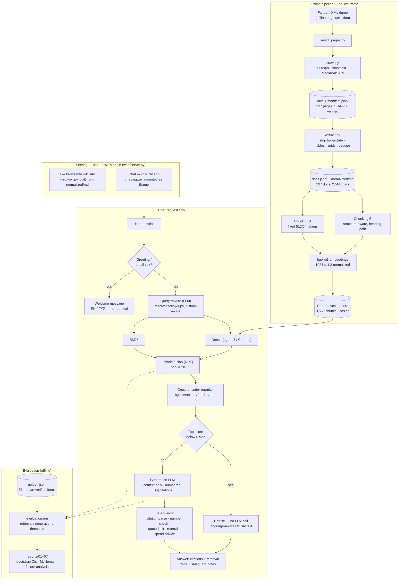

# FanBot architecture

Current system as of `main` (`f069c90`) — offline ingestion/indexing, the FastAPI serving layer, the live chat request
flow, and the evaluation harness. See `README.md` for the repository layout and `reports/` for the measured numbers
behind each stage.

## Notes

- **Two chunking strategies** are both indexed and compared (report 02, 04); **B is used in the live pipeline** because
  it preserves heading paths and table headers that cited answers need.
- **The refusal gate runs before any LLM call** — if the top reranked score is below `REFUSE_BELOW` (0.52, tuned on
  dev), the bot refuses without spending a generation call.
- **Chitchat bypass**: greetings/thanks/"who are you" skip retrieval entirely and get a canned welcome message (EN or
  中文, detected from the question).
- **Safeguards run on every generated answer**, not just a special-cased subset: citation parsing/validity, a
  verbatim-number check against the cited sources, a 25-word quote-length cap, a human-referral detector (payments,
  refunds, account issues), and a spend-advice guard (facts only, never a pull/spend recommendation).
- The retrieval pool and the generation LLM both feed the **evaluation harness**, which is how reports 04–06 get their
  Recall@k/MRR/nDCG numbers and answer-correctness/refusal metrics with bootstrap CIs and McNemar tests.
